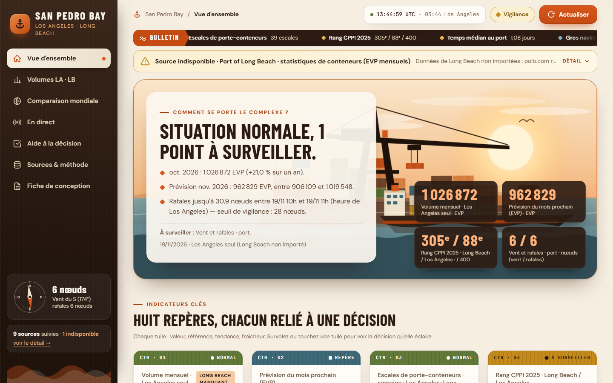
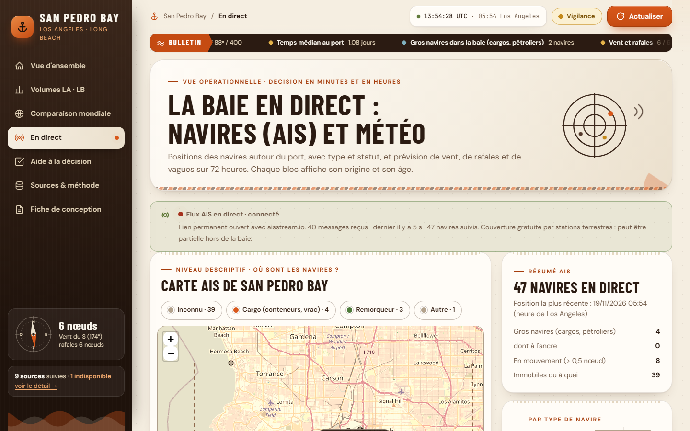
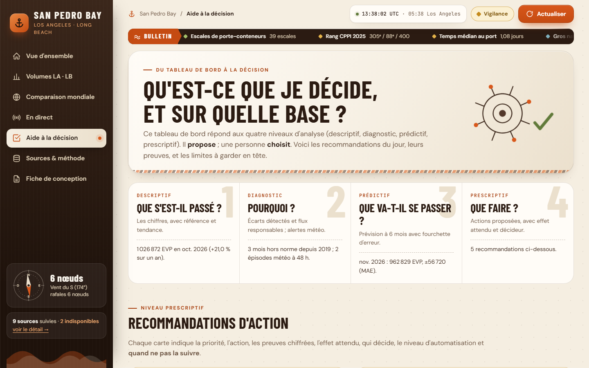

# San Pedro Bay · tableau de bord portuaire (Django)

Tableau de bord du complexe portuaire de **San Pedro Bay (Los Angeles + Long Beach)** : volumes de conteneurs, position face aux
autres ports du monde (dont **Djibouti**), vue en direct (navires AIS + météo), prévision avec marge d'incertitude, détection
d'anomalies, alertes météo et recommandations d'action.

Projet individuel facultatif · IA sectorielle, secteur portuaire · Master 2. Construit selon la séquence 6 (partie 2) du cours :
*du tableau de bord à la décision* (fiche de conception, quatre niveaux d'analyse, niveaux d'automatisation, limites).



| En direct (AIS + météo) | Aide à la décision |
|---|---|
|  |  |

*(Captures du 19/11/2026. La vue « En direct » montre les navires reçus en direct d'aisstream.io (47 au moment de la capture, 40 messages reçus après 25 secondes de lien) ; le type d'un navire n'est connu qu'après réception de son message statique, d'où le groupe « Inconnu » sur une écoute courte.)*

---

## 1. Démarrer

```powershell
cd Dashboard_San_Pedro_Bay
python -m venv .venv ; .venv\Scripts\activate
pip install -r requirements.txt
python manage.py migrate
python manage.py runserver            # http://127.0.0.1:8000
```

La base `db.sqlite3` fournie contient déjà les données chargées le **18/11/2026**. Pour tout retélécharger :

```powershell
python manage.py fetch_all            # POLA, CPPI, CNUCED, PortWatch, météo + recalcul des analyses
python manage.py fetch_all --offline  # recharge seulement les CSV de data/processed (aucun réseau)
python manage.py test tests           # 37 tests automatisés
python manage.py export_static        # instantané HTML autonome dans docs/export/ (ouvrir index.html, sans Python)
```

### Design : « registre de quai »

Interface pensée comme un document de port : **sable** (fond papier et carte marine), **orange conteneur** (couleur d'action et série principale), **brun** (barre latérale, titres), avec l'ardoise de mer, l'ocre, l'olive et la brique pour les états.

| Élément | Choix |
|---|---|
| Typographies | *Barlow Condensed* (titres et chiffres, comme les inscriptions des conteneurs), *DM Sans* (texte), *JetBrains Mono* (codes et heures) |
| Identité de port | panorama animé du port (portique, navire, conteneurs, vagues, soleil, mouettes), tuiles en forme de conteneurs ondulés, cordage, bulletin défilant, **boussole reliée au vent réel** |
| Animations | apparition échelonnée au défilement, compteurs, mini-courbes qui se dessinent, graphiques qui se révèlent, transitions entre pages (View Transitions), tuiles qui se soulèvent ; uniquement `transform` et `opacity`, 160-420 ms |
| Responsive | ordinateur : barre latérale ; tablette : rail d'icônes ; téléphone : barre d'onglets en bas et tiroir « Plus » ; graphiques, tableaux et cartes adaptés ; cibles tactiles ≥ 44 px |
| Accessibilité | lien d'accès direct au contenu, focus visible, contrastes ≥ 4,5:1, état jamais indiqué par la couleur seule (icône et texte), `prefers-reduced-motion` respecté |

### Deux étapes manuelles (et pourquoi)

| Étape | Pourquoi | Comment |
|---|---|---|
| **Long Beach** | `polb.com` refuse l'accès : HTTP 403 en automatique (18/11/2026) et **« Access Denied » même dans un navigateur ordinaire** depuis le réseau de l'étudiant (19/11/2026). Le code **ne contourne pas** ce blocage. | Si le CSV mensuel (TEU) de <https://polb.com/business/port-statistics/> est obtenu par une voie légitime (autre réseau, camarade, enseignante), l'enregistrer en `data/raw/polb_teu_monthly.csv` puis `python manage.py import_polb`. **Sans ce fichier, les volumes et la prévision portent sur Los Angeles seul** et l'écran le dit : c'est une limite documentée, pas une erreur. |
| **Flux AIS en direct** | `aisstream.io` exige une clé personnelle (gratuite). | Créer une clé sur <https://aisstream.io>, copier `.env.example` en `.env`, renseigner `AISSTREAM_API_KEY`, puis lancer `python manage.py runserver` : **le serveur ouvre tout seul un lien permanent** avec le flux et les navires bougent à l'écran en temps réel, sans rien relancer. Sans clé : l'archive AIS du TP est affichée, **clairement marquée « archive »**. |

**Aucune clé d'API n'est écrite dans le code ni dans les fichiers.** `.env` est ignoré par git ; la clé est lue dans l'environnement au
moment de l'exécution et n'est ni stockée ni affichée. Un test automatisé vérifie qu'aucun motif de clé n'est présent.

---

## 2. Sources : adresse et date de récupération

### En bref : d'où viennent les données

| Ce que montre le tableau de bord | Organisme qui produit la donnée | Comment je l'obtiens |
|---|---|---|
| Volumes mensuels de conteneurs de **Los Angeles** (importations, exportations, vides) | **Port of Los Angeles** (statistiques officielles du port) | tableaux HTML publics, lus par `pandas` |
| Volumes de **Long Beach** | **BTS** (ministère américain des Transports) jusqu'en août 2023, puis **estimation** à partir des tonnes PortWatch | API ouverte sans clé ; le site du port refuse l'accès |
| Classement et score de temps au port (**CPPI**, 3 éditions) | **Banque mondiale** et S&P Global Market Intelligence | annexe Excel 2025 et rapports PDF 2023 et 2024 |
| Escales, temps médian, débit, connectivité maritime, par pays | **CNUCED** (UNCTADstat) | archives publiques de l'API |
| Escales quotidiennes et **tonnes de conteneurs** (dont **Djibouti**) | **FMI PortWatch** (estimations à partir des signaux AIS des navires) | service ArcGIS public |
| Navires en direct (positions, types, statuts) | **aisstream.io** (réseau de récepteurs AIS) ; à défaut, archive **MarineCadastre** (NOAA/BOEM) fournie avec le TP | lien WebSocket **permanent** tenu par le serveur (clé personnelle gratuite, jamais envoyée au navigateur) ; archive locale |
| Vent, rafales, vagues, actuels et prévus | **Open-Meteo** (modèles météo globaux) | API publique sans clé |
| Fond de carte de la vue « En direct » | **OpenStreetMap** (tuiles publiques, © OpenStreetMap) | chargées par le navigateur ; la carte garde ses marqueurs si le fond ne charge pas |

Les adresses exactes, les dates de récupération, les périodes et les fichiers produits sont dans le tableau détaillé ci-dessous. Le tableau de bord
n'invente aucune valeur : une donnée absente est signalée par un message à l'écran, et une estimation est toujours affichée comme telle.

### Détail : adresse et date de récupération

Toutes les données ont été récupérées le **18/11/2026**. Les copies brutes sont dans `data/raw/`, les fichiers nettoyés dans `data/processed/`.

| # | Donnée demandée | Adresse | Récupérée le | Période obtenue | Fichier produit |
|---|---|---|---|---|---|
| 1 | **Port of Los Angeles** : EVP mensuels (importations, exportations, vides, total) | <https://www.portoflosangeles.org/business/statistics/container-statistics> → pages `historical-teu-statistics-2019` … `-2026` | 18/11/2026 | 01/2019 → 10/2026 (94 mois) | `pola_monthly_teu.csv` |
| 2 | **Port of Long Beach** : mêmes volumes | <https://polb.com/business/port-statistics/> | tentée le 18/11/2026 | **non obtenu** : accès refusé (403 / « Access Denied ») | `polb_monthly_teu.csv` (seulement après import manuel, voir §1) |
| 2b | **Long Beach, EVP totaux** (source de remplacement) : **BTS** (ministère américain des Transports), jeux `rd72-aq8r` et `iahn-a7j4` | <https://data.bts.gov/d/rd72-aq8r> · <https://data.bts.gov/resource/iahn-a7j4.json> (domaine public, API sans clé) | 19/11/2026 | 01/2019 → 08/2023 (56 mois), **total seulement** | `bts_long_beach_total_teu.csv` |
| 3 | **CPPI** (Banque mondiale) : score et rang de Los Angeles, Long Beach, **Djibouti**, Fuzhou (1ᵉʳ en 2025), Singapour, Rotterdam, Savannah, Djeddah | CPPI 2020-2025 (annexe Excel, juin 2026) : <https://www.worldbank.org/en/topic/transport/publication/cppi> (fichier : `https://openknowledge.worldbank.org/server/api/core/bitstreams/9cf20807-7dcd-4de7-9de2-fdb2d0589a73/content`) · CPPI 2020-2024 : <https://documents1.worldbank.org/curated/en/099091925073051415/pdf/P509479-9781ba16-3dbc-4064-9d8f-8eaf9951e09d.pdf> · CPPI 2023 : <https://documents1.worldbank.org/curated/en/099060324114539683/pdf/P17583313892300871be641a5ea7b90e0e6.pdf> | 18/11/2026 (2023, 2024) ; 19/11/2026 (2025) | **3 éditions** : 2023 (rang), 2024 (rang), **2025 (scores 2020-2025 et rang, 400 ports)** | `cppi_annexe_2020_2025.csv`, `cppi_annexe_2020_2024.csv`, `cppi_2023_rang_publie.csv` |
| 4 | **CNUCED (UNCTADstat)** : escales, temps médian au port, + débit et connectivité | `https://unctadstat-api.unctad.org/bulkdownload/<jeu>/<jeu>` pour `US.PortCallsArrivals`, `US.PortCalls`, `US.ContPortThroughput`, `US.PLSCI`, `US.LSCI` | 18/11/2026 | escales/temps 2018-2023 ; débit 2010-2024 ; connectivité 2006T1-2026T3 | `unctad_long.csv` |
| 5 | **AIS en direct** | `wss://stream.aisstream.io/v0/stream` (documentation : <https://aisstream.io/documentation>) | **en continu** (lien permanent, clé requise) ; copie en base toutes les 20 s | positions < 6 h, affichage des navires vus dans les 30 dernières minutes | table `AisPosition` |
| 5 bis | AIS archive (repli et référence horaire) | extrait **MarineCadastre** (NOAA/BOEM) <https://marinecadastre.gov/ais/>, fourni avec le TP (`ais_clean.csv`) | construite le 18/11/2026 | 23/02 → 01/03/2026 | `ais_archive_snapshot.csv`, `ais_baseline_hourly.csv` |
| 6 | **Météo** : vent, rafales, vagues, actuels et prévus | <https://api.open-meteo.com/v1/forecast> et <https://marine-api.open-meteo.com/v1/marine> (sans clé) | à chaque actualisation (≥ 15 min d'écart) | 24 h passées + 72 h prévues | table `WeatherPoint` |
| + | **FMI PortWatch** (ajout) : escales quotidiennes **et tonnes de conteneurs** de 4 ports, **Djibouti compris** ; sert aussi de mesure de volume du **complexe entier** | `https://services9.arcgis.com/weJ1QsnbMYJlCHdG/arcgis/rest/services/Daily_Ports_Data/FeatureServer/0` (ports 664, 294, 1201, 1114) · <https://portwatch.imf.org/> | 18/11/2026 | 01/2019 → 13/11/2026 | `portwatch_daily_portcalls.csv` |

**Pourquoi PortWatch en plus ?** (1) La CNUCED ne publie pas Djibouti dans ses séries d'escales et de temps médian (voir §5) : PortWatch est la seule source de la liste où Djibouti est comparable aux autres ports sur la même mesure. (2) Long Beach étant inaccessible, PortWatch fournit gratuitement, depuis 2019, les **tonnes de conteneurs du complexe Los Angeles-Long Beach** (estimation du FMI à partir des signaux AIS) : sur 94 mois, la corrélation avec les EVP de Los Angeles est de **0,94** (0,95 à l'import), à environ 22 tonnes par EVP chargé importé. La page Volumes l'affiche comme mesure du complexe entier ; ce sont des **tonnes estimées, pas des EVP, et le complexe n'est pas séparé port par port**.

---

## 3. Traitements et méthode

| Sujet | Traitement |
|---|---|
| **Volumes** | Lecture du tableau mensuel de chaque année (`pandas.read_html`), conversion en nombres, **contrôle : total publié = somme des 4 composantes (à 0,5 %)**, aucun mois manquant toléré. Un total illisible à la source (novembre 2020, publié « 889.,748.15 ») est reconstitué par la somme des composantes et **signalé**. Le complexe = Los Angeles + Long Beach **sur les mois communs** ; si Long Beach manque, périmètre « Los Angeles seul » affiché partout. |
| **CPPI** | **Édition 2025 (juin 2026)** : annexe Excel officielle « CPPI 2020-2025 », lue par intitulés de colonnes (scores 2020-2025, rang 2025). Éditions 2024 et 2023 : tableaux des rapports PDF extraits **par coordonnées** (PyMuPDF), pour les rangs publiés 2024 (403 ports, sans doublon) et 2023. Contrôle croisé : les scores 2020-2024 de l'annexe 2025 coïncident avec ceux du PDF (**0 écart > 2 points sur plus de 300 ports**). Les rangs 2020-2022 ne sont pas publiés, donc **non affichés**. |
| **CNUCED** | Archives `.7z` de l'API publique, filtrées sur les pays et ports de comparaison. Djibouti absent des séries d'escales : message explicite, pas de valeur inventée. |
| **Prévision** | 3 modèles comparés par **backtest** sur 24 dates passées (prévision à 6 mois avec les seules données connues alors) : naïf saisonnier, ratio annuel, Holt-Winters (tendance amortie + saison 12). Le plus précis est retenu. **Fourchette = prévision ± MAE de l'horizon** (méthode du cours) ; une bande « 80 % des erreurs passées » est ajoutée, plus prudente. Contrôle de vraisemblance avant affichage. |
| **Anomalies** | Décomposition **STL robuste** (période 12) ; mois signalé si |z| ≥ 3 (z = reste / (1,4826 × MAD)) **et** écart ≥ 8 % de l'attendu (matérialité). Diagnostic : flux le plus touché (importations chargées, exportations chargées, vides) par rapport au même mois un an avant. Escales hebdomadaires : écart à la médiane des 26 semaines précédentes. |
| **Alertes météo** | Seuils de vigilance et d'alerte (vent 21/34 nœuds, rafales 28/34, vagues 2,5/4 m, visibilité 2 000 m), épisodes regroupés (une alerte par épisode), horizon 48 h. Seuils dans `dashboard/constants.py`. |
| **Recommandations** | Règles écrites (`services/analytics/recommend.py`) : chaque action affiche ses preuves chiffrées, l'effet attendu, le décideur, le niveau d'automatisation et « à ne pas suivre si ». |
| **Actualisation** | Les pages **lisent la base** : aucun appel d'API à chaque rafraîchissement. La météo n'est rappelée qu'après 15 minutes (`WEATHER_TTL_SECONDS`) ; l'AIS est alimenté par un processus séparé (`collect_ais`). Chaque source garde adresse, date de récupération et état. |

### Fonctions « intelligentes » (niveaux d'analyse du cours)

| Niveau | Dans le tableau de bord |
|---|---|
| Descriptif | tuiles à 4 éléments, volumes, carte de chaleur, comparaison mondiale |
| Diagnostic | anomalies mensuelles avec flux responsable, alertes météo, file d'attente AIS |
| Prédictif | **prévision à 6 mois avec marge d'incertitude** (backtest affiché) |
| Prescriptif | **recommandations d'action** (niveau d'automatisation 3 : l'outil recommande, l'humain valide) |

---

## 4. Fiche de conception

`docs/fiche_conception.pdf` (une page A4) : pour qui, quelle décision, 8 indicateurs avec leur référence, forme, fraîcheur, intelligence,
niveau d'automatisation, avec **maquette de l'écran**. La même fiche est dans l'application (page « Fiche de conception »).

## 5. Limites (à lire avant d'utiliser les chiffres)

* **Long Beach** : accès refusé par le site (403 en automatique, « Access Denied » dans un navigateur ordinaire depuis le réseau de l'étudiant). Long Beach n'est donc observé que jusqu'en août 2023 (BTS, total mensuel) ; après, il est estimé (voir ci-dessous) et le détail import/export/vides n'est connu que pour Los Angeles. La prévision et les anomalies portent sur Los Angeles (observé), pas sur le complexe estimé. L'import est prêt si le fichier du port devient disponible.
  Sources de remplacement : le **BTS** donne le total mensuel de Long Beach (officiel) jusqu'en août 2023, puis le tableau de bord **estime** Long Beach à partir des tonnes de conteneurs du complexe (PortWatch) : erreur moyenne de **3,9 % sur le complexe** (rétro-test 2021-2023), vérifiée sur trois mois de 2026 mis de côté (écarts de −1,4 %, +3,2 % et −0,7 % sur Long Beach). C'est une **estimation**, tracée en pointillés avec sa bande d'erreur, jamais présentée comme une donnée du port. Autres voies examinées le 19/11/2026 : **MacroMicro** réserve l'historique aux abonnés payants (seul le dernier mois est visible : 997 177 EVP en septembre 2026) ; un graphique **Datawrapper** du Signal Tribune s'arrête en avril 2021 ; les **rapports PMSA** ne donnent que les EVP chargés des deux derniers mois de chaque numéro ; **CEIC** est payant ; les communiqués de presse ne couvrent que quelques mois de 2026.
* **Djibouti à la CNUCED** : UNCTADstat ne publie que 22 économies individuelles dans les séries d'escales et de temps médian ; Djibouti n'y est pas. Repères alternatifs : débit en EVP, connectivité (PLSCI/LSCI), escales PortWatch. Le regroupement « Afrique de l'Est » est un repère régional, jamais présenté comme Djibouti.
* **CNUCED, période** : escales et temps médian s'arrêtent en **2023** ; le temps médian est une médiane **par pays**, pas par port.
* **Sources différentes, grandeurs différentes** : le CPPI est un **score** de temps au port (pas un volume), la CNUCED donne des chiffres **par pays**, PortWatch compte des **navires**. Les comparaisons se font en rang ou en indice (2019 = 100), jamais en valeur brute.
* **CPPI** : les éditions 2023, 2020-2024 et 2025 n'ont pas exactement le même périmètre (405, 403 puis 400 ports ; Yangshan est regroupé avec Shanghai en 2025) et un rang bouge beaucoup d'une année à l'autre (Los Angeles : 359ᵉ en 2024, 88ᵉ en 2025 ; Djibouti : 364ᵉ puis 53ᵉ) : on lit la direction, pas l'écart au rang près.
* **AIS** : la couverture gratuite d'aisstream.io (stations terrestres) est partielle : sur la zone de Los Angeles, le flux apporte quelques messages par seconde au mieux, et le **type d'un navire n'est connu qu'après réception de son message statique** (d'où un groupe « Inconnu » en début d'écoute). Le flux a été **testé en conditions réelles le 19/11/2026**, en local puis sur le site en ligne : lien permanent ouvert, une dizaine de messages en 20 secondes et plus de 80 navires suivis dans le navigateur. La clé est personnelle : le serveur seul la détient, le navigateur reçoit uniquement les positions. L'archive du TP est un extrait de 7 jours d'hiver : sa référence horaire est indicative.
* **Météo** : modèles globaux (~11 km vent, ~5 km vagues), indicatifs, pas une mesure au quai ; vagues calculées au large de la jetée.
* **Prévision** : ne voit pas les chocs (grève, tempête, tarifs). Fiabilité mesurée sur 24 dates passées ; la fourchette « ± MAE » contient la valeur réelle environ 6 fois sur 10 : lire l'ordre de grandeur, pas une garantie.
* **Seuils météo** : pédagogiques, inspirés des avis du NWS ; une capitainerie applique ses propres limites.
* **Dernier mois publié** : les ports peuvent réviser leurs chiffres récents.
* **Coquille à la source** : le total de novembre 2020 est illisible sur le site de Los Angeles (« 889.,748.15 ») ; il est remplacé par la somme des quatre composantes (889 746 EVP), et la source l'indique.

## 6. Structure

```
config/                  réglages Django (aucun secret)
dashboard/
  models.py              tables : sources, volumes, CPPI, CNUCED, PortWatch, météo, AIS, analyses
  constants.py           adresses, ports comparés, seuils d'alerte
  services/collectors/   un module par source (pola, polb, cppi, unctad, portwatch, weather, ais) ; ais_stream = lien permanent avec le direct
  services/analytics/    prévision, anomalies, alertes, indicateurs (kpi), recommandations
  services/viewdata.py   données des pages (lecture de la base uniquement)
  views.py, urls.py      7 pages + API JSON
  templates/, static/    interface (Plotly et Leaflet embarqués : fonctionne hors CDN)
  management/commands/   fetch_all, import_polb, collect_ais, fetch_weather, build_ais_archive
data/raw, data/processed copies brutes et fichiers nettoyés
docs/                    fiche de conception (PDF), captures
tests/                   37 tests (pages avec base vide, prévision, anomalies, alertes, AIS, import Long Beach, BTS, estimation Long Beach, lecture Los Angeles, tonnes PortWatch, absence de clé)
```

## 7. Code source et déploiement

* **Code** : <https://github.com/Kenzo72026/Dashbord>
* **Application en ligne** : <https://san-pedro-bay-dashboard.onrender.com> (hébergée sur Render, offre gratuite, déploiement automatique à chaque envoi sur GitHub). Sur l'offre gratuite, le service **se met en veille après quelques minutes sans visite** : la première page peut mettre une cinquantaine de secondes à s'afficher.

Le tableau de bord est une application Django classique. Les fichiers de déploiement sont dans le dépôt :

| Fichier | Rôle |
|---|---|
| `render.yaml` | description du service Render (Python 3.13, clé secrète générée par la plateforme, aucun secret dans le fichier) |
| `build.sh` | installation des dépendances, `collectstatic`, `migrate` |
| `requirements.txt` | dépendances, dont `gunicorn` (serveur) et `whitenoise` (fichiers statiques) |

Commande de démarrage : `gunicorn config.wsgi:application --bind 0.0.0.0:$PORT --workers 1 --threads 16 --timeout 120` (un seul processus : il porte le lien permanent avec le flux AIS ; chaque navigateur connecté au direct occupe un fil). Variables d'environnement : `DJANGO_DEBUG=0`,
`DJANGO_SECRET_KEY` (générée), `RENDER_EXTERNAL_HOSTNAME` (fournie par Render : elle alimente `ALLOWED_HOSTS` et les origines CSRF) et, si l'on veut le flux AIS en direct,
`AISSTREAM_API_KEY` (saisie dans le tableau de bord Render, jamais dans le code) : dès que la clé existe, le serveur ouvre à la première page un **lien permanent** avec le flux AIS, dans un fil de fond du processus qui répond (`dashboard/services/collectors/ais_stream.py`) et le diffuse aux navigateurs en continu (`/api/ais/stream/`, Server-Sent Events). `AIS_AUTOSTART=0` l'empêche.

**Données en ligne** : la base `db.sqlite3` du dépôt contient les données du 18-19/11/2026. Le disque de l'offre gratuite est **éphémère** : une actualisation faite en ligne
(météo) est perdue au prochain déploiement, et la commande `fetch_all` ne tourne pas sur cette offre. Le lien AIS se coupe quand le service est en veille et se rouvre au réveil. Pour une mise à jour régulière, il faut
relancer `fetch_all` en local puis pousser la base, ou passer à une offre avec tâche planifiée.

En local ou ailleurs : `DJANGO_DEBUG=0`, `DJANGO_ALLOWED_HOSTS=<domaine>`, `DJANGO_SECRET_KEY=<clé>`, `python manage.py collectstatic`, puis un serveur WSGI
(`gunicorn config.wsgi` ou `waitress-serve config.wsgi:application`). Planifier `python manage.py fetch_all` (chaque nuit, par exemple) et `python manage.py collect_ais --loop` (en continu).
